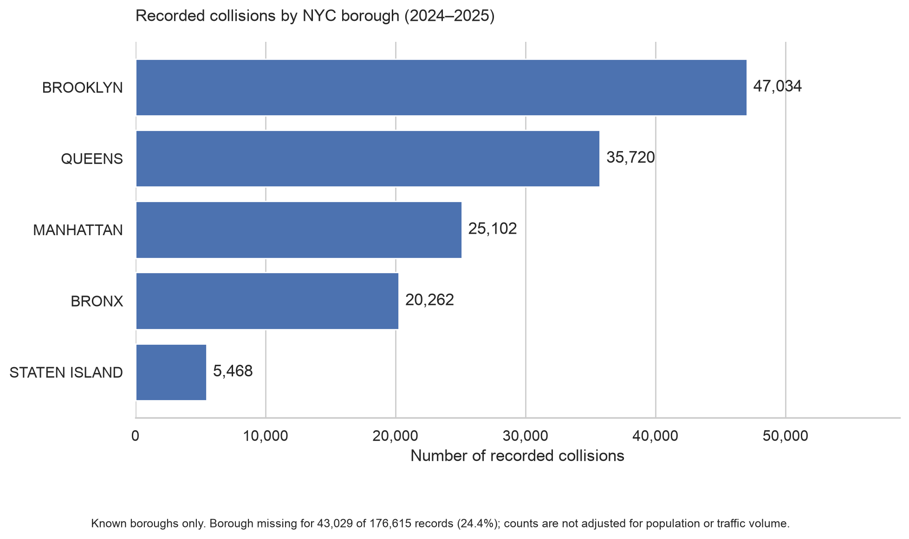
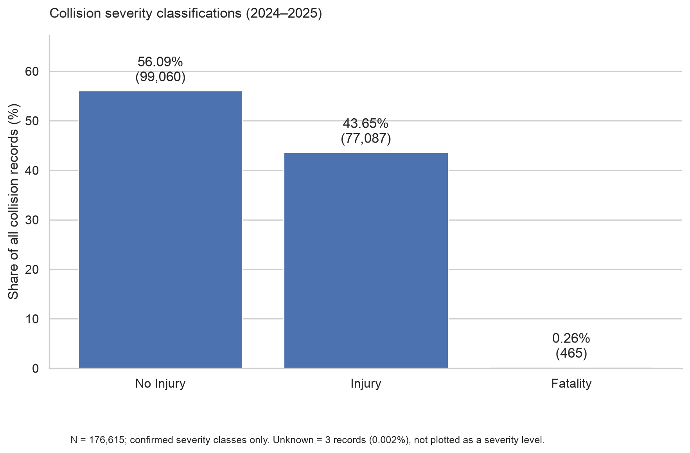
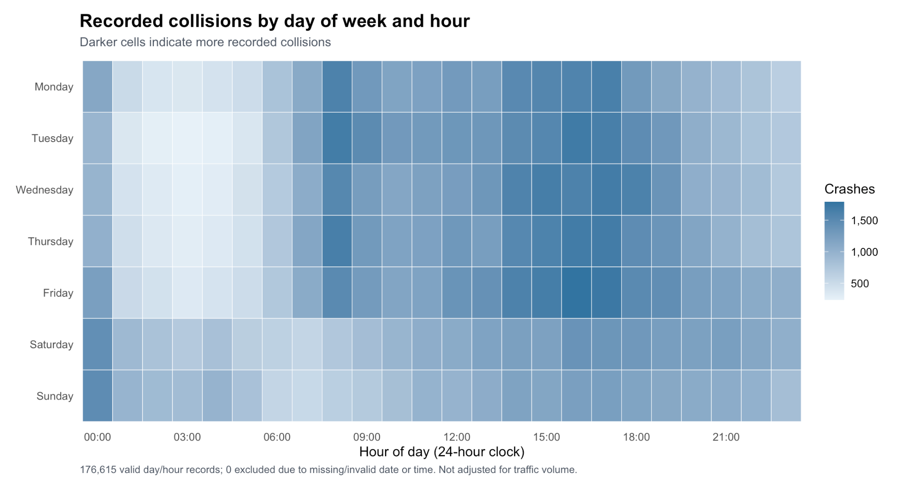
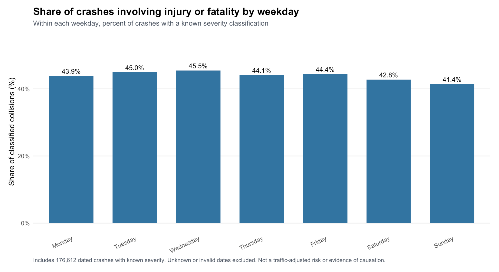

# NYC Motor Vehicle Collision Analysis

**Graduate Data Analytics Research Project | In Progress**

This project examines patterns in New York City motor vehicle collisions using records from 2024 and 2025. I am using Python, R, MySQL, MongoDB, and AWS to explore the data, compare results across tools, and investigate geographic, temporal, and severity-related patterns.

The dataset contains **176,615 collision records** and **29 original fields**. It comes from the NYPD's [Motor Vehicle Collisions – Crashes dataset](https://data.cityofnewyork.us/Public-Safety/Motor-Vehicle-Collisions-Crashes/h9gi-nx95), published through NYC Open Data.

## Research questions

1. Which New York City borough had the highest number of recorded collisions during 2024–2025?
2. Which contributing factors were most frequently associated with crashes involving injuries or fatalities?
3. How did collision frequency and severity vary by time and day of the week?

The first question has been explored through borough counts. The third is being examined through hourly, weekly, and monthly patterns. Analysis of contributing factors is in progress.

## Tools and methods

| Tool | How I used it |
| --- | --- |
| **Python** (pandas, NumPy, Matplotlib, Seaborn) | Data inspection, missing-value checks, severity classification, and visualizations |
| **R** (ggplot2) | Descriptive statistics, monthly trends, weekday/hour patterns, and severity comparisons |
| **MySQL / SQL** | Relational schema, data import, quality checks, and summary queries |
| **MongoDB** | Document-based storage and aggregation pipelines |
| **AWS EC2, S3, and RDS** | Remote Python execution, object storage, and cloud-hosted MySQL analysis |
| **macOS command line** | Basic CSV inspection and frequency checks |

## Preliminary findings

### Geographic distribution



**Brooklyn had the most recorded collisions among records with an identified borough (47,034), followed by Queens (35,720).** Borough information was missing in **43,029 records (24.4%)**, so the comparison does not cover every collision. These are raw counts, not rates adjusted for population or traffic volume.

### Collision severity



I created an ordered *Crash Impact* variable using reported injury and fatality counts. Source-aware validation produced **99,060 No Injury**, **77,087 Injury**, and **465 Fatality** classifications. Three records could not be fully classified because their fatality counts were missing. Percentages in the chart use all 176,615 records.

### Time of day and day of week



The heatmap shows differences in recorded collision volume across weekdays and hours. A separate check found **3,380 records at exactly 00:00**; some times may be rounded or entered as defaults, so midnight patterns require careful interpretation. The counts are not adjusted for traffic volume.

### Severity by weekday



The share of classified crashes involving injury or fatality ranged from **41.4% on Sunday to 45.5% on Wednesday**. These descriptive percentages compare recorded crashes, not the risk of a crash per trip, and do not establish why the pattern occurs.

Additional figures: [monthly collision totals](visualizations/r/04_r_monthly_collision_trend.png), [average collisions per calendar day](visualizations/r/07_r_average_collisions_per_day.png), and [people injured per collision](visualizations/python/03_people_injured.png).

## Data validation

Comparing results across languages and databases revealed a difference in how three missing fatality counts were handled. The original CSV contained blank fatality values for three collisions with reported injuries, while the inspected MySQL and MongoDB records stored numeric zeros. The initial MySQL import also reported three warnings involving blank integer values.

I updated the Python and R analyses to keep these cases **Unknown** rather than treating missing fatality counts as confirmed zeros. The existing database imports are documented separately; their severity totals have not yet been reconciled with the updated classification. I also checked the injury-count statistics against the source file, confirming a mean of **0.586** and a sample standard deviation of **0.853**.

Details are available in the [data validation notes](docs/data_validation_notes.md).

## Project files

| Folder | Contents |
| --- | --- |
| [`python/`](python/) | Exploratory analysis and chart-generation scripts |
| [`r/`](r/) | R analysis and visualization scripts |
| [`sql/`](sql/) | MySQL schema and exploratory SQL queries |
| [`mongodb/`](mongodb/) | MongoDB aggregation pipelines |
| [`visualizations/`](visualizations/) | Exported Python and R charts |
| [`aws/`](aws/) | EC2, S3, and RDS implementation notes and screenshots |
| [`docs/`](docs/) | Data validation notes |

The original CSV is not included in this repository. The analyses use a locally saved 2024–2025 extract (`Motor_Vehicle_Collisions_-_Crashes_20260831.csv`); results may differ from a new download because the public dataset is updated over time.

## Running the analysis locally

Place the matching CSV extract in a local `data/` folder at the repository root. The commands below create an isolated Python environment and run the analysis from the project root (macOS/Linux):

```bash
python3 -m venv .venv
source .venv/bin/activate
python -m pip install -r requirements.txt
python python/crash_analysis.py
python python/create_portfolio_charts.py
```

The R scripts can be opened in RStudio with the project root as the working directory; they use `ggplot2`. Database queries require a separately imported copy of the dataset. The AWS services were configured for this project and are described in the [AWS implementation notes](aws/README.md).

## Current work

I'm extending the contributing-factor analysis, exploring additional relationships between crash characteristics and severity, and refining the statistical interpretation for the final research paper. I'm also documenting how missing values affect the results across database systems.
