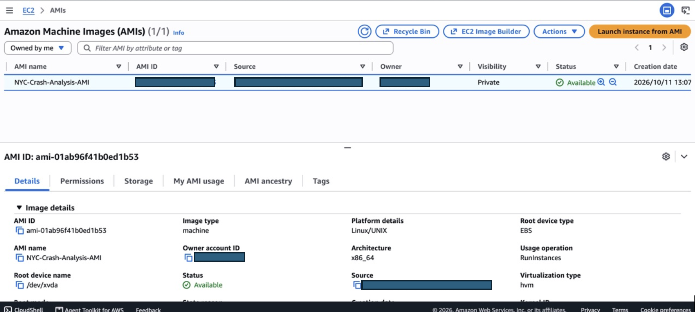
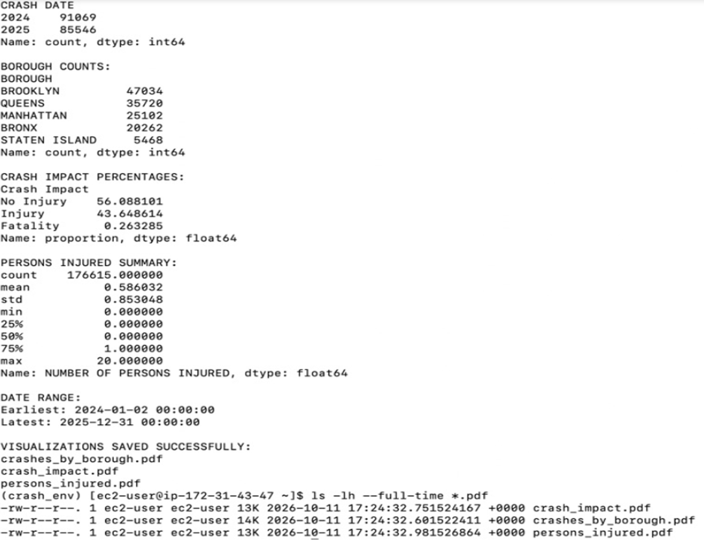
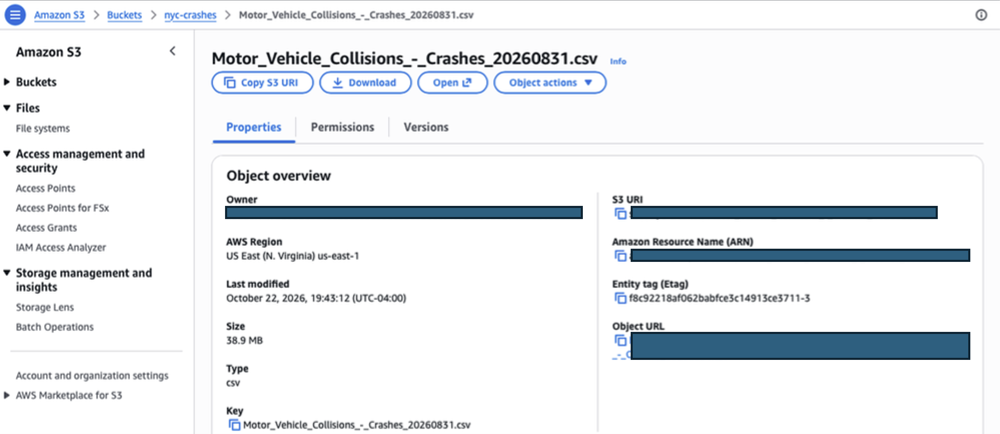
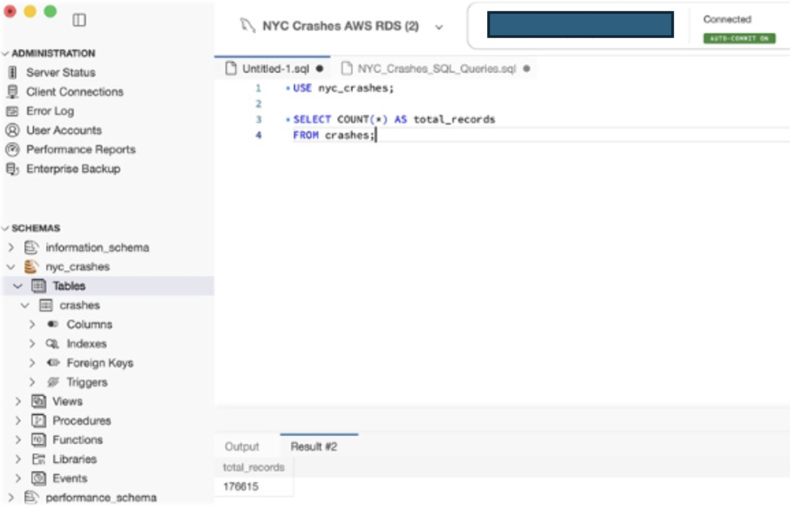
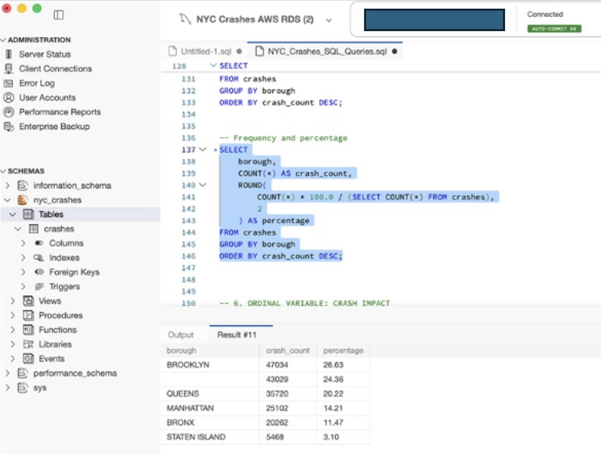

# AWS Implementation

As part of my NYC collision analysis, I worked with **Amazon EC2, S3, and RDS for MySQL** to explore different approaches to running code, storing data, and querying a cloud database. These were separate implementations using the same 2024–2025 dataset, rather than a single automated pipeline.

## Amazon EC2: Remote Python analysis

I launched an Amazon Linux EC2 instance, connected using SSH, transferred the dataset and Python files, and installed the required packages. After running the analysis, I created an **Amazon Machine Image (AMI)** and launched a second instance from that image. The analysis also ran in the recreated environment.

*Figure 1. AMI created from the configured EC2 instance.*

*Figure 2. Python analysis executing on an EC2 instance launched from the AMI. This is an earlier execution, before the severity classification was revised to preserve missing values.*

## Amazon S3: Dataset storage

I uploaded the collision CSV to an S3 bucket, checked its object details, and verified access to the stored file. I also uploaded a SQL script as part of the later database assignment. Public read access was enabled for the course exercise using this public dataset.

*Figure 3. Collision dataset stored as an S3 object.*

## Amazon RDS for MySQL: Database queries

I created an RDS MySQL instance, connected through MySQL Workbench, defined a **29-column** `crashes` table, and imported **176,615 rows** from a local CSV using MySQL Shell. I checked the import with SQL queries, then ran borough summaries, missing-value checks, and other exploratory queries.

The S3 storage exercise and RDS database import were separate: **the RDS import came from a local file**, not directly from S3.

*Figure 4. Row-count query confirming 176,615 records in the RDS database.*

*Figure 5. SQL aggregation of collisions by borough, including records with missing borough information.*

### Import validation

The MySQL import generated three warnings for blank values in an integer field. In the original CSV, three collision records have missing fatality counts; the inspected MySQL and MongoDB copies stored numeric zeros for these records. That difference affected the original Crash Impact counts.

My current Python and R analyses preserve those records as **Unknown** severity. The original cloud database import remains documented as executed; it has not been replaced with a corrected import.

Further details are in the [data validation notes](../docs/data_validation_notes.md).

[Return to project overview](../README.md)
